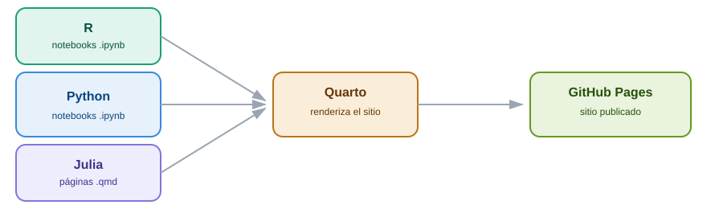

## Sobre el proyecto

Operación Jupyter es el proyecto de servicio social de la División de Ciencias Básicas, Facultad de Ingeniería, UNAM. Reúne tutoriales de introducción a tres lenguajes de programación de código libre — **Julia**, **Python** y **R** — pensados para quien empieza desde cero.

## Elige un lenguaje

::: {style="display:flex; gap:16px; flex-wrap:wrap; margin: 1.5rem 0;"}

::: {.lang-card data-lang="jl"}
### Julia
Cómputo numérico de alto desempeño con sintaxis de alto nivel.

[Empezar →](julia/01-introduccion.qmd)
:::

::: {.lang-card data-lang="py"}
### Python
Propósito general, ecosistema enorme, fácil de aprender.

[Empezar →](python/01-introduccion.ipynb)
:::

::: {.lang-card data-lang="r"}
### R
Estadística y gráficos, con RStudio como su entorno natural.

[Empezar →](r/01-introduccion.ipynb)
:::

:::

También puedes ir directo a los **[Tutoriales comparativos](tutoriales/index.qmd)** (ejercicios, quiz, ficha descargable) o revisar **[Mi progreso](progreso.qmd)**.

## Más herramientas

- [Comparar lenguajes](comparar.qmd): el mismo problema resuelto en Julia, Python y R.
- [Ejercicio aleatorio](aleatorio.qmd): practica con uno al azar.

## Cómo se arma el sitio

### Cómo usar este sitio

Cada tutorial cubre, en el mismo orden para los tres lenguajes, para poder comparar directamente:

- Instalación e interfaces (RStudio, Google Colab, Jupyter)
- Tipos de datos y declaración de variables
- Estructuras de control (secuencias, decisiones, repeticiones)
- Estructuras de datos y objetos
- Funciones
- Particularidades del lenguaje
- Ejercicios de ingeniería
- Visualización

### Cómo se ejecuta el código

**Julia** va primero en el orden de Jupyter (Julia, Python, R), pero **no se ejecuta en vivo**: todavía no tiene un equivalente maduro para el navegador, así que sus tutoriales muestran el código con salidas precalculadas. El código de **Python** y **R** sí se ejecuta en vivo en tu navegador, sin instalar nada.
